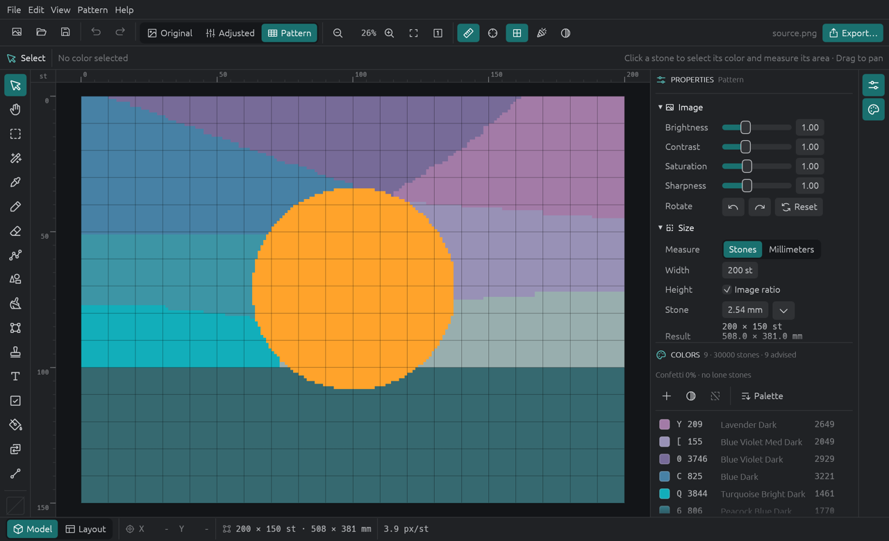
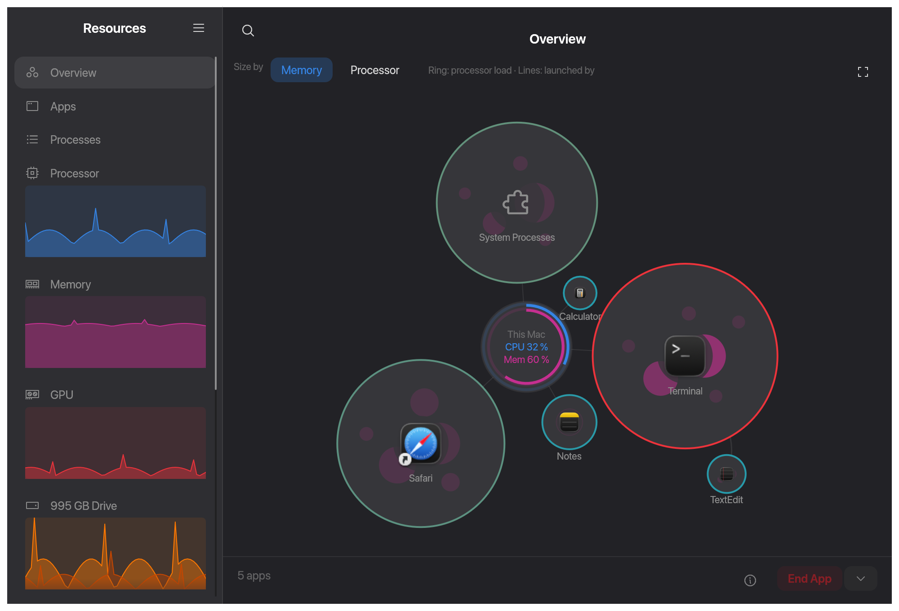
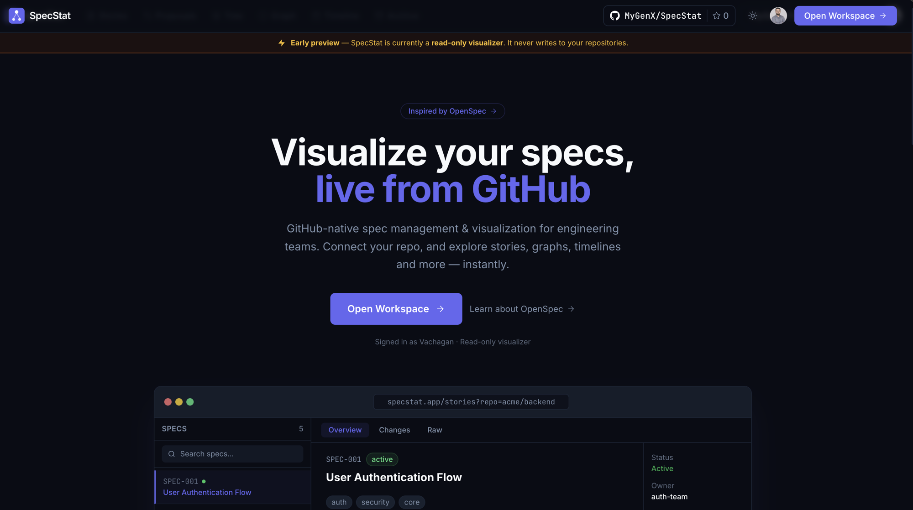
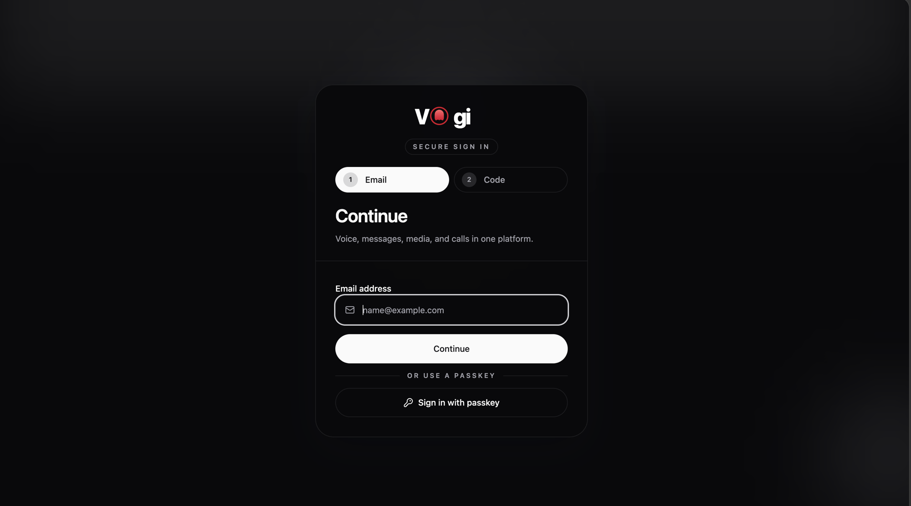

# Hi, I'm Vachagan 👋

**Senior Python Developer @ EPAM Systems** · Backend & distributed systems · AI-native development · Yerevan, Armenia 🇦🇲

## About Me
I'm **Vachagan Grigoryan**, a **Senior Python Developer** at **EPAM Systems**, based in **Yerevan, Armenia**. Since April 2026 I've been building backend services for healthcare platforms: Python and TypeScript services with REST and GraphQL APIs on AWS, built with an AI-native engineering workflow.

I have 7+ years of backend experience with Python and TypeScript, using FastAPI, Django, Strawberry GraphQL, NestJS, and Express.js, and hands-on work in Go and Rust. Before EPAM, I spent over three years at **Devico** on the **CTRL Wallet (XDEFI)** multichain wallet, building microservices, blockchain indexers, and Web3 infrastructure. Earlier work covers fintech, NFT marketplaces, and e-commerce. I care about clean architecture, automation, and performant, maintainable systems.

On the infrastructure side, I've designed and run environments on AWS and Azure, automated delivery with CI/CD, and managed containerized workloads with Docker and Kubernetes. I also run a fully self-hosted home lab. Outside work, I build native desktop and WebAssembly apps in Rust with egui.

AI-native development is central to how I work. I ship software through spec-driven workflows with Claude Code and other coding agents, write custom agent skills and rules that encode team conventions, integrate Model Context Protocol (MCP) servers, and build agentic and RAG systems with LangChain and LangGraph.

## 💼 Currently
- 🏥 **Senior Python Developer @ [EPAM Systems](https://www.epam.com)** (Apr 2026 – present), backend services for the healthcare domain
- 🐍 Python (FastAPI, Pydantic) and TypeScript services with **REST & GraphQL** APIs, running on **AWS**
- 🤖 **AI-native development**: coding agents, custom agent skills, MCP tooling, and LLM-powered features
- 🦀 Side projects: Rust desktop/WebAssembly apps and open-source Python tooling under [MyGenX](https://github.com/MyGenX)

## 🚀 Featured Projects

<table>
  <tr>
    <td width="50%" valign="top">
      
      <h3>🎨 <a href="https://p5d.notallow.cc">5D Painting</a></h3>
      
Rust desktop &amp; browser studio that turns photos into printable diamond-painting and cross-stitch patterns: DMC/Anchor/Sulky thread matching, CIEDE2000 and dithering, and PDF/SVG/Excel/OXS export.

      
<code>Rust</code> <code>egui</code> <code>WebAssembly</code> <code>axum</code> <code>PostgreSQL</code>

      
<a href="https://p5d.notallow.cc">Website</a> · <a href="https://github.com/VachaganGrigoryan/p5d-releases/releases/latest">Download</a>

    </td>
    <td width="50%" valign="top">
      
      <h3>📊 <a href="https://resources.vachagan.dev">Resources for Mac</a></h3>
      
Native macOS system monitor inspired by GNOME Resources: a bubble overview of apps and processes, CPU/GPU/memory/drive/network/battery pages, a menu bar extra, and a desktop widget.

      
<code>Rust</code> <code>egui</code> <code>macOS</code> <code>Homebrew</code>

      
<a href="https://resources.vachagan.dev">Website</a> · <a href="https://github.com/VachaganGrigoryan/resources-mac">GitHub</a> · <code>brew install --cask VachaganGrigoryan/tap/resources-mac</code>

    </td>
  </tr>
  <tr>
    <td width="50%" valign="top">
      
      <h3>🗂️ <a href="https://specstat.vachagan.dev">SpecStat</a></h3>
      
Serverless UI for OpenSpec that turns specs into Kanban boards, dependency graphs, trees, and timelines, with GitHub Actions as the only backend.

      
<code>Next.js</code> <code>TypeScript</code> <code>Turborepo</code> <code>GitHub Actions</code>

      
<a href="https://specstat.vachagan.dev">Website</a> · <a href="https://github.com/MyGenX/SpecStat">GitHub</a>

    </td>
    <td width="50%" valign="top">
      
      <h3>💬 <a href="https://chat.vachagan.dev">Vogi</a></h3>
      
Realtime chat and calling platform with WebRTC audio/video calls, presence, and media messaging, plus web and Android clients. A Rust microservices backend is in progress.

      
<code>FastAPI</code> <code>Socket.IO</code> <code>WebRTC</code> <code>Redis</code> <code>Rust</code>

      
<a href="https://chat.vachagan.dev">Website</a> · <a href="https://github.com/VachaganGrigoryan/VoiceChat">API</a> · <a href="https://github.com/VachaganGrigoryan/web-voice-chat">Frontend</a>

    </td>
  </tr>
</table>

### 📦 Open Source · [MyGenX](https://github.com/MyGenX)
| Project | What it is | Links |
| --- | --- | --- |
| **[FastQL](https://github.com/MyGenX/FastQL)** | Code-first Python GraphQL framework with its own execution engine, DI, subscriptions, Federation v2, and FastAPI/Starlette/Django/Flask integrations | [Docs](https://fastql.vachagan.dev) · [PyPI](https://pypi.org/project/mygenx-fastql/) |
| **[TypeWall](https://github.com/MyGenX/TypeWall)** | Strict, schema-first runtime validation for Python with structured errors, composable schemas, and JSON Schema/OpenAPI output | [Docs](https://typewall.mintlify.app) · [PyPI](https://pypi.org/project/typewall/) |
| **[Imperator](https://github.com/MyGenX/Imperator)** | Stack-aware rules compiler for AI coding agents: one rule set compiled for Claude Code, Cursor, Codex, and Gemini | [GitHub](https://github.com/MyGenX/Imperator) |
| **[pybi](https://github.com/MyGenX/pybi)** | Go CLI that generates Python projects from external template catalogs | [Templates](https://github.com/MyGenX/python-templates) |
| **[tasgi](https://github.com/MyGenX/tasgi)** | Experimental ASGI runtime running handlers safely across asyncio and thread runtimes | [PyPI](https://pypi.org/project/tasgi/) |

### 🧩 More Apps & Tools
| Project | What it is | Stack |
| --- | --- | --- |
| **[Formula](https://github.com/VachaganGrigoryan/Formula)** | CAD-style formula workbench with live interactive viewports (Fourier, Lorenz, Mandelbrot, Bézier…) and LaTeX/Jupyter export | Rust · egui · WASM |
| **[TiVi](https://tivi.vachagan.dev)** | IPTV ecosystem: playlist sync, EPG browsing, web companion, and an LG webOS TV app | Next.js · Django · webOS |
| **[Resume Builder](https://resume.vachagan.dev)** | Privacy-first, client-side CV builder with multiple templates and JSON export | React · TypeScript |
| **[Freestudio](https://freestudio.vachagan.dev)** | Browser-based, Photoshop-inspired image editor | React · TypeScript |
| **[Family Tree](https://fy-tree.vercel.app)** | Family tree builder with visualization and PNG/PDF export | React · Supabase |

👉 Full portfolio with case studies: **[vachagan.dev](https://vachagan.dev)**

## 🧭 Experience
| Period | Company | Role |
| --- | --- | --- |
| Apr 2026 – Present | **EPAM Systems** | Senior Python Developer (healthcare) |
| Dec 2022 – Mar 2026 | **Devico** · client: CTRL Wallet (XDEFI) | Senior Backend / Blockchain Developer |
| Apr 2022 – Dec 2022 | **S-Pro** | Python Developer (part-time) |
| Jun 2021 – Mar 2022 | **Zestbloom Inc.** | Python / Django Developer |
| Sep 2019 – May 2021 | **Instigate Mobile CJSC** | SQA Python Engineer |
| Feb 2017 – Apr 2019 | **Independent** | Software Developer |

## 🔧 Tech Stack

  

| Area | Tools |
| --- | --- |
| **Languages** | Python, TypeScript, Rust, Go |
| **Backend & APIs** | FastAPI, Pydantic, Django / DRF, Strawberry GraphQL, NestJS, Express.js, gRPC |
| **Data & Messaging** | PostgreSQL, Redis, NoSQL, NATS, RabbitMQ, Celery |
| **Cloud & DevOps** | AWS, Azure, Docker, Kubernetes, Terraform, GitHub Actions, Linux |
| **Observability** | OpenTelemetry, Jaeger, Prometheus, Grafana |
| **AI / LLM** | Claude Code, Custom Agent Skills, MCP, RAG, AI Agents, LangChain, LangGraph, OpenAI Codex |
| **Desktop & Web** | egui, WebAssembly, Next.js, React, Tailwind CSS |
| **Domains** | Healthcare, Fintech, Blockchain / Web3, E-commerce |

## 🎓 Recent Learning
Anthropic courses (2026): *AI Fluency: Framework & Foundations* · *Claude 101* · *Claude Code 101* · *Introduction to Model Context Protocol* · *Building with the Claude API*

## 🤝 Looking for Collaborators
I'm looking for contributors and potential long-term maintainers to help grow the [MyGenX](https://github.com/MyGenX) open-source organization, especially:

- **[FastQL](https://github.com/MyGenX/FastQL):** GraphQL engine development, framework integrations, tests, docs, performance, and ecosystem tooling.
- **[TypeWall](https://github.com/MyGenX/TypeWall):** validation features, typing, integrations, docs, benchmarks, and release engineering.

Start with a focused issue, a docs improvement, a test, or a pull request. Developers interested in sustained ownership can grow into reviewing changes, shaping roadmaps, and maintaining releases. TypeWall has a [contribution guide](https://github.com/MyGenX/TypeWall/blob/main/CONTRIBUTING.md); for FastQL, open an issue or discussion before starting a substantial change.

## 📫 Get in Touch
- 🌐 **Website:** [vachagan.dev](https://vachagan.dev)
- 💼 **LinkedIn:** [Vachagan Grigoryan](https://www.linkedin.com/in/vachagan-grigoryan/)
- ✈️ **Telegram:** [@VachaganGrigoryan](https://t.me/VachaganGrigoryan)
- ✉️ **Email:** grigoryan@vachagan.dev

Always happy to connect with fellow developers. ✨
